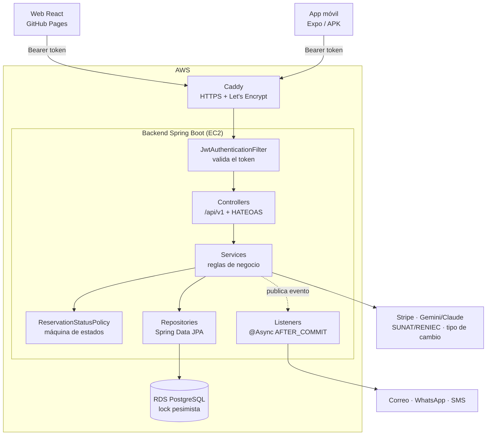
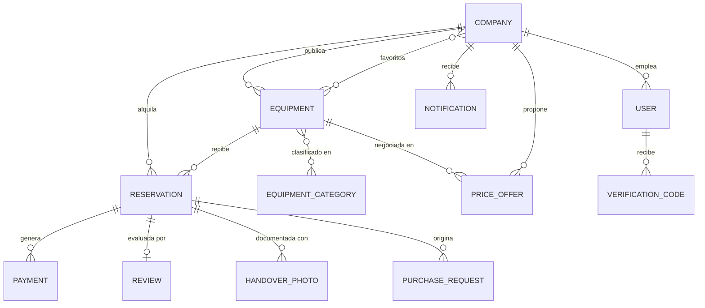

# RentEquip — Marketplace B2B de Alquiler de Maquinaria de Construcción

**Curso:** CS 2031 — Desarrollo Basado en Plataforma<br>
**Docente:** Yarasca Moscol, Julio Eduardo<br>
**Lima, Perú — 2026**

**Integrantes:**

| Integrante | Código |
|---|---|
| Ayala Vega, Valeria Isabel | 202310180 |
| Cadenas Hidalgo, Anthony Darian | 202510031 |
| Ramos Calderón, Mary Sofía | 202510158 |
| Rodrigo Corzo, Ernesto | 202310441 |
| Rojas Llanos, Sergio | 202410758 |

**Repositorio backend:** https://github.com/sergio453LOL/BackendRentequipV2<br>
**Repositorio frontend (web + móvil):** https://github.com/sergio453LOL/FrontendRentequipV2<br>
**Web en vivo:** https://sergio453lol.github.io/FrontendRentequipV2/<br>
**API en vivo:** https://184-197-5-219.sslip.io/swagger-ui.html<br>
**Evidencias de Deployment AWS y Swagger:** https://drive.google.com/drive/u/3/folders/1xaAGR4s1PUR31v4fTu4G2omBxdpoc3hD

---

## Índice

1. [Introducción](#1-introducción)
2. [Identificación del Problema o Necesidad](#2-identificación-del-problema-o-necesidad)
3. [Descripción de la Solución](#3-descripción-de-la-solución)
4. [Modelo de Entidades](#4-modelo-de-entidades)
5. [API REST y Endpoints](#5-api-rest-y-endpoints)
6. [Manejo de Errores](#6-manejo-de-errores)
7. [Medidas de Seguridad Implementadas](#7-medidas-de-seguridad-implementadas)
8. [Eventos y Asincronía](#8-eventos-y-asincronía)
9. [Instalación y Ejecución Local](#9-instalación-y-ejecución-local)
10. [GitHub & Management](#10-github--management)
11. [Conclusión](#11-conclusión)
12. [Apéndices](#12-apéndices)

> [Evidencias de Deployment](#evidencias-de-deployment) — enlaces a la API en vivo, la web y las capturas.

---

## 1. Introducción

### Contexto

El sector construcción peruano lo dominan contratistas pequeños y medianos que operan por proyecto. Cada obra exige un parque de maquinaria distinto y, al terminar, ese equipo queda inmovilizado hasta el siguiente contrato. El resultado: capital ocioso de un lado y demanda insatisfecha del otro, sin canal que los conecte.

### Objetivos del Proyecto

- **Publicar** maquinaria en desuso con especificaciones, tarifas, ubicación y estado.
- **Buscar por proximidad** (coordenadas + radio), filtrando por categoría, ciudad, tarifa y ventana de fechas libre.
- Garantizar mediante un **flujo transaccional** que dos empresas jamás obtengan la misma máquina en fechas superpuestas, incluso bajo peticiones simultáneas.
- Modelar el **ciclo de vida** de la reserva con reglas explícitas sobre quién ejecuta cada transición.
- Cerrar el ciclo con **pago con tarjeta, comprobante y reseñas verificadas**, y proteger todo con **autenticación JWT, roles y verificación en dos pasos**.
- **Fase 2:** servir a una web en React y una app móvil en React Native, todo desplegado en AWS con HTTPS.

## 2. Identificación del Problema o Necesidad

### Descripción del Problema

Un contratista que necesita una retroexcavadora por doce días puede comprarla (capital muerto entre obra y obra) o alquilarla a un proveedor tradicional con tarifas infladas por la intermediación. Mientras tanto, otra constructora tiene esa misma máquina parada. No existe canal que los conecte porque el alquiler entre empresas exige resolver tres problemas: saber **qué hay cerca**, **si está libre en las fechas exactas** y que la reserva sea **firme**.

### Justificación

Lo tercero convierte esto en un problema de backend. Si dos contratistas reservan la misma excavadora para la misma semana, alguien llega a la obra y la máquina no está. Entre el "está libre" y el "reservado" hay una ventana por la que otra petición puede colarse, así que tratamos el overbooking como una invariante de base de datos, no como una validación de formulario.

## 3. Descripción de la Solución

### Funcionalidades Implementadas

**Gestión de empresas y usuarios.** Alta de empresas con RUC y email únicos; cada una agrupa usuarios con tres roles (`ADMIN`, `MANAGER`, `OPERATOR`). Contraseñas con BCrypt, nunca expuestas. Una regla impide dejar a una empresa sin administrador y la baja es lógica, para preservar el historial. El registro admite **empresa (RUC 20)** o **persona (RUC 10 / DNI)**.

**Catálogo de maquinaria.** Marca, modelo, año, serie única, tarifas, depósito, imágenes, ubicación y si incluye operador. Cada equipo admite múltiples categorías (N:M). Las fotos se suben por `multipart` (`/uploads/images`).

**Búsqueda por proximidad.** `GET /api/v1/equipment/search` implementa Haversine en JPQL: calcula kilómetros entre el origen y cada equipo, filtra por radio y **ordena por cercanía** (o por precio, año o recientes con `sort`). Los demás filtros son opcionales; `null` desactiva el predicado. Con fechas, un `NOT EXISTS` excluye los equipos con reservas solapadas, así el catálogo solo muestra lo reservable. `GET /equipment/{id}/blocked-dates` devuelve los días ocupados para el calendario.

**Reservas sin overbooking.** El núcleo del proyecto. Al crear una reserva, el servicio abre una transacción `READ_COMMITTED` y toma un **lock pesimista** (`SELECT ... FOR UPDATE`, timeout de 5 s) sobre la fila del equipo. Ese lock serializa dos peticiones concurrentes: bloquear la tabla de reservas no bastaría, porque **las filas que todavía no existen no se pueden bloquear**. Con el lock tomado se valida el rango de fechas, que el equipo sea alquilable, que el arrendatario no sea el dueño y que no haya solapamiento; recién entonces se inserta. La segunda petición recibe `409 OVERBOOKING`.

**Ciclo de vida de la reserva.** `ReservationStatusPolicy` concentra la máquina de estados (`PENDING → CONFIRMED → IN_PROGRESS → COMPLETED`, con `CANCELLED` y `REJECTED` como salidas) y quién puede ejecutar cada transición.

**Reseñas verificadas.** Solo el arrendatario de una reserva `COMPLETED` puede reseñarla (1 a 5 estrellas y comentario), y solo una vez. `GET /reviews/ratings` da el promedio por equipo.

**Funcionalidades de la Fase 2:**

| Módulo | Qué hace |
|---|---|
| **Pagos con Stripe** | El navegador tokeniza la tarjeta con Stripe.js; el backend solo recibe el token (`pm_` o `tok_`), nunca el número, así queda fuera del alcance PCI. El alquiler es un `PaymentIntent` capturado y el depósito un `PaymentIntent` con captura manual (el dinero queda retenido en la tarjeta). Sin `STRIPE_SECRET_KEY` se usa `SimulatedPaymentGateway`, que acepta y rechaza los mismos tokens de prueba que Stripe. |
| **Comprobante de pago** | Al pagar, el comprobante sale **automáticamente por correo**. Desde la reserva también se reenvía por **WhatsApp** (WhatsApp Empresas o Twilio) o **SMS** (SMS Gateway), a pedido, porque esos canales cuestan por mensaje. |
| **Negociación de precio** | El arrendatario propone una tarifa; el dueño acepta, rechaza o contraoferta; el arrendatario responde. Una oferta aceptada se aplica al reservar (`PriceOffer`, estados `PENDING → COUNTERED → ACCEPTED → USED`). |
| **Alquiler con opción de compra** | El dueño pone la máquina en venta con precio y porcentaje del alquiler que se descuenta. El arrendatario con reserva confirmada pide comprarla, el dueño acepta y el comprador paga el saldo con tarjeta. |
| **Fotos de entrega y devolución** | Las dos empresas de la reserva suben fotos del estado de la máquina al entregarla y al devolverla, con la ubicación GPS de cada foto. |
| **Notificaciones** | Bandeja in-app por empresa (`/notifications`): cada cambio de reserva, oferta o compra genera un aviso, con contador de no leídos. |
| **Asistente IA** | `POST /assistant/chat` recomienda maquinaria del catálogo real. Usa **Gemini** primero, luego **Claude** y, sin claves, un buscador local por palabras clave. Protegido por `AssistantGuard` (filtro de temas), cuotas por usuario (5/min, 30/h) y global (500/día), caché de 15 min y límite de 400 tokens de salida. |
| **Verificación SUNAT / RENIEC** | `GET /identity/ruc/{ruc}` y `/identity/dni/{dni}` llenan el registro solos. Se prueba apisperu, luego Decolecta y al final la API gratuita de apis.net.pe. `RucValidator` revisa el dígito verificador (módulo 11) sin red. Una empresa `ACTIVO` y `HABIDO` recibe la insignia de verificada. |
| **Verificación en dos pasos** | Opcional, por correo o SMS, con código de 6 dígitos (ver sección 7). |
| **Dashboard del arrendador** | `GET /companies/me/dashboard`: equipos publicados, reservas activas como dueño y como arrendatario, solicitudes pendientes e ingreso estimado, para las tarjetas y gráficos de la web. |
| **Tipo de cambio** | `GET /exchange-rate` muestra precios en soles y dólares (open.er-api.com, con respaldo si no responde). |
| **Catálogo de demostración** | Con `DEMO_DATA_ENABLED=true`, `DemoDataSeeder` y `RegionalCatalogSeeder` cargan maquinaria real con fotos y 16 empresas en las regiones del Perú, para que la demo nunca empiece vacía. |

**Extras:** paginación en todos los listados, HATEOAS, Swagger UI, logging con SLF4J y Docker Compose.

### Tecnologías Utilizadas

| Capa | Tecnología |
|---|---|
| Lenguaje | Java 21 |
| Framework | Spring Boot 4.1.1 (Web MVC, Data JPA, Security, Validation, HATEOAS) |
| Persistencia | PostgreSQL 16 + Hibernate (RDS en producción) |
| Documentación | springdoc-openapi 3.1.0 (Swagger UI) |
| Pagos | Stripe (PaymentIntents) con pasarela simulada de respaldo |
| Correo | JavaMailSender + Thymeleaf; Mailpit en local, Gmail SMTP en producción |
| Mensajería | WhatsApp Empresas / Twilio (WhatsApp) y SMS Gateway |
| IA | Google Gemini y Anthropic Claude vía `RestClient` |
| APIs externas | apisperu, Decolecta y apis.net.pe (SUNAT/RENIEC), open.er-api.com (tipo de cambio) |
| Testing | JUnit 5, Spring Boot Test, AssertJ, H2 en modo PostgreSQL |
| Build | Maven (wrapper incluido) |
| Contenedores | Docker + Docker Compose |
| Infraestructura | AWS EC2 + RDS + Elastic IP, Caddy (HTTPS con Let's Encrypt) |
| Utilidades | Lombok, SLF4J |

### Arquitectura del sistema



El camino sólido es sincrónico; el punteado corre tras el commit en otro hilo, sin afectar al tiempo de respuesta ni a la transacción.

## 4. Modelo de Entidades



**Descripción de entidades.** Todas heredan de `BaseEntity`: `id` autogenerado, `createdAt`/`updatedAt` de Hibernate y un `equals`/`hashCode` seguro frente a proxies Lazy.

- **Company** — empresa o persona del marketplace; actúa como arrendadora y arrendataria. RUC y email únicos, coordenadas validadas, insignia de verificada por SUNAT.
- **User** — persona que opera en nombre de una empresa. Email único, contraseña BCrypt, rol enumerado y canal de verificación en dos pasos.
- **Equipment** — maquinaria publicada. Serie única, tarifas `DECIMAL(12,2)`, estado (`AVAILABLE`, `RENTED`, `MAINTENANCE`, `INACTIVE`), ubicación indexada por `(latitude, longitude)`, imágenes como `@ElementCollection`, operador incluido y precio de venta opcional.
- **EquipmentCategory** — taxonomía del catálogo, con nombre único.
- **Reservation** — contrato temporal. Guarda la tarifa y el depósito **congelados al momento de reservar**, de modo que un cambio de precio posterior no altere reservas existentes. Índice compuesto `(equipment_id, start_date, end_date)` y `@AssertTrue` que impide rangos invertidos.
- **Payment** — pagos de la reserva (`RENTAL`, `SECURITY_DEPOSIT`, `REFUND`) con estado y referencia única del `PaymentIntent` de Stripe.
- **Review** — reseña 1:1 con la reserva, con unicidad en columna.
- **PriceOffer** — negociación de tarifa entre arrendatario y dueño.
- **PurchaseRequest** — solicitud de compra de una máquina alquilada.
- **HandoverPhoto** — foto de entrega o devolución (`HandoverStage`) con coordenadas y la empresa que la subió.
- **Notification** — aviso de la bandeja in-app de una empresa.
- **VerificationCode** — código de un solo uso (hash BCrypt) para el login en dos pasos.

**Decisiones de diseño.** Las relaciones `@ManyToOne` son `LAZY`, con `JOIN FETCH` explícito solo donde el DTO necesita el grafo. El cascade es `ALL` de empresa a usuarios, pero solo `PERSIST/MERGE` hacia equipos y reservas: borrar una empresa no debe borrar historial. Notificaciones, ofertas y códigos usan `@OnDelete(CASCADE)` porque no tienen valor sin su dueño.

## 5. API REST y Endpoints

Todos los recursos cuelgan de `/api/v1/`, en plural, con verbos HTTP semánticos y `ResponseEntity` explícito. Documentación interactiva en [Swagger UI](https://184-197-5-219.sslip.io/swagger-ui.html) (`http://localhost:8080/swagger-ui.html` en local).

| Recurso | Endpoints |
|---|---|
| Autenticación | `POST /auth/register` · `POST /auth/login` · `POST /auth/login/verify` · `POST /auth/refresh` (públicos) |
| Empresas | `POST /companies` · `GET /companies` · `GET /companies/{id}` · `PATCH /companies/{id}` · `DELETE /companies/{id}` · `GET /companies/{id}/users` · `GET /companies/{id}/equipment` · `GET /companies/me/dashboard` · `POST /companies/me/verification` |
| Usuarios | `POST /users` · `GET /users/me` · `PATCH /users/me` · `POST /users/me/password` · `POST /users/me/two-factor/setup` · `/confirm` · `/disable` · `GET /users/{id}` · `PATCH /users/{id}` · `DELETE /users/{id}` |
| Categorías | `POST /equipment-categories` · `GET /equipment-categories` · `GET /{id}` · `PUT /{id}` · `DELETE /{id}` |
| Maquinaria | `POST /equipment` · `GET /equipment/{id}` · `PATCH /equipment/{id}` · `DELETE /equipment/{id}` · `GET /equipment/search` · `GET /equipment/brands` · `GET /equipment/{id}/reservations` · `GET /equipment/{id}/blocked-dates` · `GET /equipment/{id}/reviews` |
| Reservas | `POST /reservations` · `GET /reservations` · `GET /reservations/{id}` · `PATCH /reservations/{id}/status` · `POST /reservations/{id}/confirmation` · `POST /reservations/{id}/cancellation` · `GET /reservations/availability` |
| Pagos y comprobantes | `POST /reservations/{id}/payments` · `GET /reservations/{id}/payments` · `POST /reservations/{id}/receipt-deliveries` |
| Fotos de entrega | `POST /reservations/{id}/handover-photos` · `GET /reservations/{id}/handover-photos` |
| Ofertas | `POST /offers` · `GET /offers` · `POST /offers/{id}/acceptance` · `/rejection` · `/counter` · `/cancellation` |
| Compras | `PUT /equipment/{id}/sale` · `GET /reservations/{id}/purchase-quote` · `POST /reservations/{id}/purchase-requests` · `GET /purchase-requests` · `POST /purchase-requests/{id}/acceptance` · `/rejection` · `/cancellation` · `/payment` |
| Reseñas | `POST /reviews` · `GET /reviews/{id}` · `GET /reviews?reservationId=` · `GET /reviews/ratings` · `DELETE /reviews/{id}` |
| Notificaciones | `GET /notifications` · `GET /notifications/unread-count` · `PATCH /notifications/{id}/read` · `POST /notifications/read-all` · `DELETE /notifications/{id}` · `DELETE /notifications` |
| Otros | `POST /assistant/chat` · `GET /identity/ruc/{ruc}` · `GET /identity/dni/{dni}` · `GET /exchange-rate` · `POST /uploads/images` · `POST /uploads/profile-images` |

Códigos utilizados: `200` en lecturas y actualizaciones, `201` con cabecera `Location` en creaciones, `202` cuando el login pide el segundo paso, `204` en bajas, `400` en validación, `401` sin token válido, `402` con tarjeta rechazada, `403` por rol insuficiente o recurso ajeno, `404` cuando no existe, `409` en conflictos (duplicados, overbooking, transición inválida), `429` al superar la cuota del asistente, `413` con imágenes de más de 5 MB, `502`/`503` si un proveedor externo falla o no está configurado y `500` como red de seguridad.

**Hipermedia.** Las respuestas individuales de empresas, maquinaria y reservas van envueltas en un `EntityModel` con sus enlaces en `_links`. En una reserva los enlaces de transición **dependen del estado**: `confirmation` y `cancellation` solo aparecen si la máquina de estados permite esa transición, así el cliente descubre lo que puede hacer leyendo la respuesta. Se construyen en ensambladores dedicados (`hateoas/`), no en los controladores.

## 6. Manejo de Errores

Toda excepción de dominio hereda de `RentEquipException`, que transporta su propio `HttpStatus` y un código legible por máquina. Sobre esa jerarquía hay quince excepciones especializadas: `ResourceNotFoundException`, `DuplicateResourceException`, `InvalidOperationException`, `UnauthorizedException`, `ForbiddenOperationException`, `OverbookingException`, `EquipmentUnavailableException`, `InvalidReservationDateException`, `InvalidStatusTransitionException`, `MachineHasOtherRentalsException`, `PaymentDeclinedException`, `PaymentProviderException`, `NotificationDeliveryException`, `VerificationCodeException` y `PasswordChangeException`.

`GlobalExceptionHandler` (`@RestControllerAdvice`) es el único punto donde una excepción se convierte en respuesta HTTP. Además del dominio propio captura las de Spring: validación de cuerpo y parámetros (con la lista de campos inválidos), JSON malformado, `DataIntegrityViolationException` → 409, fallos de lock → 409 con `CONCURRENT_REQUEST`, y un `Exception` final que registra el stacktrace pero devuelve un mensaje genérico.

El cuerpo es siempre el mismo `ErrorResponse`: `timestamp`, `status`, `error`, `code`, `message`, `path` y `details`. Centralizarlo permite que la web y la app parseen una sola forma de error (y traduzcan el `code` a un mensaje amigable) y que los detalles internos nunca salgan (`server.error.include-stacktrace=never`).

## 7. Medidas de Seguridad Implementadas

**Seguridad de datos.** Las contraseñas se cifran con BCrypt y ningún DTO de respuesta expone el campo. Los DTOs son el límite del sistema: las entidades JPA nunca se serializan, lo que elimina fugas al añadir campos. Credenciales y claves (Stripe, Gemini, WhatsApp, SMTP, RDS) salen de variables de entorno, y `.env` está en `.gitignore` y `.dockerignore`. Los datos de tarjeta nunca tocan el backend: solo llega el token de Stripe.

**Prevención de vulnerabilidades.** Contra **inyección SQL**, todo el acceso a datos pasa por Spring Data JPA con consultas parametrizadas (`@Param`); no hay concatenación de strings en ninguna query. Contra **XSS**, la API responde exclusivamente JSON. Contra **CSRF**, la protección se desactiva deliberadamente porque la sesión es `STATELESS`: no hay cookie que un tercero pueda reutilizar. **CORS** está restringido por patrón de origen (`localhost`, `*.vercel.app` y `sergio453lol.github.io`). Las subidas de imágenes validan el tipo (JPG, PNG, WebP) y un máximo de 5 MB. La validación opera en dos capas: `@Valid` sobre los DTOs y constraints de columna en las entidades, de forma que ni una escritura directa pueda violar las invariantes.

**Autenticación con JWT.** `POST /api/v1/auth/register` da de alta empresa y administrador en una transacción; `/auth/login` devuelve access y refresh token firmados con HMAC-SHA256, con los claims `userId`, `email`, `companyId` y `role`. `JwtAuthenticationFilter` extrae el token de `Authorization: Bearer`, lo valida y puebla el `SecurityContext`; si falta o es inválido, el `AuthenticationEntryPoint` responde 401 con el `ErrorResponse` de siempre. La clave sale de `JWT_SECRET`. `/auth/refresh` recarga al usuario desde la base en lugar de confiar en el token, para que una baja o un cambio de rol surtan efecto de inmediato. El refresh token nuevo hereda el vencimiento del anterior, así que la sesión dura como máximo `JWT_SESSION_HOURS` desde el login y después hay que volver a iniciar sesión.

**Verificación en dos pasos (opcional).** El usuario la activa en su perfil eligiendo correo o SMS (`POST /users/me/two-factor/setup` y `/confirm`; para activarla debe escribir un código de prueba, así no se bloquea con un canal que no recibe). Desde entonces `/auth/login` responde 202 con un `challengeId` en lugar de los tokens y envía un código de 6 dígitos; `/auth/login/verify` lo canjea por los tokens. El código se guarda con BCrypt, vence en 10 minutos, admite 5 intentos, sirve una sola vez y no se puede pedir otro antes de 30 segundos. Desactivarla (`/users/me/two-factor/disable`) pide la contraseña.

**Autorización en dos niveles.** El rol se comprueba con `@PreAuthorize` en los controladores (`@EnableMethodSecurity` activo): `ADMIN` gestiona usuarios, empresa y categorías, `ADMIN` y `MANAGER` publican maquinaria y confirman reservas, y cualquier autenticado reserva y reseña. La pertenencia del recurso se verifica aparte, en los servicios, que leen la identidad del `SecurityContext` vía `CurrentUser` y responden 403 ante un recurso ajeno. La empresa arrendataria **nunca viaja en el cuerpo**: sale del token.

## 8. Eventos y Asincronía

La concurrencia crítica se resolvió de forma **deliberadamente sincrónica**: disponibilidad e inserción ocurren en una sola transacción con lock pesimista, porque el usuario necesita saber en la misma respuesta si obtuvo la máquina.

Asíncrono es el trabajo posterior. `ReservationService` y `PaymentService` publican eventos con `ApplicationEventPublisher`: `ReservationCreatedEvent` al solicitarse, `ReservationStatusChangedEvent` en cada transición (con el estado anterior y el motivo) y `ReservationPaidEvent` al pagar.

| Listener | Cuándo corre | Qué hace |
|---|---|---|
| `ReservationNotificationListener` | `@Async` + `AFTER_COMMIT` | Correo a las dos empresas en cada cambio de reserva |
| `PaymentReceiptListener` | `@Async` + `AFTER_COMMIT` | Correo con el comprobante apenas se paga |
| `ReservationInboxListener` | Dentro de la transacción | Aviso en la bandeja in-app |

**Tras el commit**, porque anunciar por correo una reserva que luego hizo rollback sería una inconsistencia visible. **Asíncrono**, porque la latencia del SMTP no debe sumarse al tiempo de respuesta ni una caída del correo impedir alquilar. La bandeja in-app, en cambio, se escribe en la misma transacción: el aviso y el cambio de la reserva se confirman o se deshacen juntos.

Los eventos llevan un `ReservationSnapshot` inmutable, no la entidad: el listener corre fuera de la transacción, donde tocar una relación `LAZY` reventaría.

`EmailService` compone HTML con Thymeleaf y envía por `JavaMailSender` sobre un `ThreadPoolTaskExecutor` propio con cola acotada; los fallos se registran y se descartan. En local, `docker compose` levanta Mailpit como SMTP de captura, legible en `http://localhost:8025`.

## 9. Instalación y Ejecución Local

**Requisitos:** Docker Desktop. (JDK 21 solo si se ejecuta desde el IDE.)

```bash
git clone https://github.com/sergio453LOL/BackendRentequipV2.git
cd BackendRentequipV2
docker compose up -d --build
```

Swagger UI queda en `http://localhost:8080/swagger-ui.html`, con botón *Authorize* para pegar el token, y los correos enviados se leen en Mailpit, en `http://localhost:8025`. Para detener: `docker compose down` (`-v` borra también los datos). La guía detallada está en [`GUIA_LEVANTAR_PROYECTO.md`](GUIA_LEVANTAR_PROYECTO.md). Las **91 pruebas** (16 clases) se ejecutan con `./mvnw test` sobre H2, sin contenedores.

**Variables de entorno.** Todas son opcionales en local; en producción las pone `deploy/deploy-aws.sh` en el servicio systemd.

| Variable | Valor por defecto | Descripción |
|---|---|---|
| `DB_URL` | `jdbc:postgresql://localhost:5432/rentequip` | Cadena de conexión |
| `DB_USERNAME` / `DB_PASSWORD` | `postgres` / `postgres` | Credenciales de base de datos |
| `DDL_AUTO` | `update` | Estrategia de esquema de Hibernate |
| `PORT` | `8080` | Puerto del servidor |
| `JWT_SECRET` | clave de desarrollo | Clave de firma de los tokens, mínimo 32 bytes. **Obligatorio en producción** |
| `JWT_ACCESS_MINUTES` | `15` | Vigencia del access token |
| `JWT_SESSION_HOURS` | `8` | Duración máxima de la sesión desde el login; al renovar el token no se alarga |
| `CORS_ALLOWED_ORIGINS` | `http://localhost:*,https://*.vercel.app,https://sergio453lol.github.io` | Orígenes permitidos |
| `MAIL_HOST` / `MAIL_PORT` | `localhost` / `1025` | SMTP. En Docker apunta a Mailpit |
| `MAIL_USERNAME` / `MAIL_PASSWORD` / `MAIL_SMTP_AUTH` / `MAIL_SMTP_TLS` | vacío / `false` | Credenciales SMTP (Gmail con contraseña de aplicación en producción) |
| `MAIL_ENABLED` | `true` | `false` desactiva el envío y solo registra |
| `MAIL_FROM` | `no-reply@rentequip.pe` | Remitente de las notificaciones |
| `STRIPE_SECRET_KEY` | vacío | Clave `sk_test_...`. Sin ella, pagos con la pasarela simulada |
| `WHATSAPP_EMPRESAS_TOKEN` | vacío | Comprobante por WhatsApp Empresas. Si falta, se usa Twilio |
| `TWILIO_ACCOUNT_SID` / `TWILIO_AUTH_TOKEN` / `TWILIO_WHATSAPP_FROM` | vacío | WhatsApp por Twilio |
| `SMS_GATEWAY_URL` / `SMS_GATEWAY_TOKEN` | vacío | Servidor SMS Gateway y su API key para comprobantes y códigos por SMS. Sin ellos, ese envío responde 503 |
| `SMS_GATEWAY_SIMS` | vacío | IDs de SIM del gateway separados por coma; sin ellos usa su SIM por defecto |
| `APISPERU_TOKEN` | vacío | Consulta RUC/DNI en apisperu (primera opción) |
| `IDENTITY_API_TOKEN` | vacío | Token de Decolecta (segunda opción). Sin tokens se usa la API gratuita de apis.net.pe |
| `GEMINI_API_KEY` / `GEMINI_MODEL` | vacío / `gemini-3.5-flash-lite` | Asistente IA con Gemini |
| `ANTHROPIC_API_KEY` / `ASSISTANT_MODEL` | vacío / `claude-opus-5-5` | Asistente IA con Claude (respaldo) |
| `ASSISTANT_LIMIT_PER_MINUTE` / `_PER_HOUR` / `_PER_DAY` | `5` / `30` / `500` | Cuotas del asistente |
| `DEMO_DATA_ENABLED` / `DEMO_PASSWORD` | `false` / vacío | Carga el catálogo de demostración y crea los administradores demo |
| `UPLOADS_DIR` | `uploads` | Carpeta de las fotos subidas |
| `EXCHANGE_RATE_URL` / `USD_PEN_FALLBACK` | open.er-api.com / `3.75` | Tipo de cambio; si la API no responde se usa el último valor o el de respaldo |

## 10. GitHub & Management

**Control de versiones**. Usamos Conventional Commits (`feat(api)`, `feat(security)`, `fix(deploy)`, `docs`), ramas por funcionalidad (`feature/stripe-payments`, `feature/sms-comprobantes`, reseñas) y Pull Requests revisados por otro integrante antes de mergear a main. El `.gitignore` excluye `target/`, `.env` y la configuración del IDE: no hay credenciales en el historial.

**Gestión de tareas.** Las tareas del proyecto se definieron como issues con etiquetas, responsable y milestone en `docs/github-issues.md`, y se coordinaron mediante ramas por funcionalidad y Pull Requests.

**GitHub Actions**. El workflow `.github/workflows/ci.yml` se ejecuta en cada push y Pull Request: prepara Java 21 y corre `./mvnw -B verify`, que compila y ejecuta toda la suite de pruebas, incluida la de concurrencia. Así ningún cambio que rompa las pruebas llega a main sin que el PR lo muestre. En el repositorio del frontend, `deploy-pages.yml` publica la web en cada push a main.

## Evidencias de Deployment

Instancia EC2 `t3.small` (Amazon Linux 2023) con **Elastic IP** `184.197.5.219`, contra PostgreSQL en **RDS**. La base **no es accesible públicamente**: su security group solo admite el 5432 desde el del backend.

| Recurso | Enlace |
|---|---|
| Web (GitHub Pages) | https://sergio453lol.github.io/FrontendRentequipV2/ |
| API en vivo (Swagger UI) | https://184-197-5-219.sslip.io/swagger-ui.html |
| Health check | https://184-197-5-219.sslip.io/actuator/health |
| Especificación OpenAPI | https://184-197-5-219.sslip.io/v3/api-docs |
| App móvil | Proyecto Expo `@sergiorojas/rentequip`, APK con EAS Build |
| **Evidencias de Deployment AWS y Swagger** | [Carpeta en Google Drive](https://drive.google.com/drive/u/3/folders/1xaAGR4s1PUR31v4fTu4G2omBxdpoc3hD) |

Verificado en producción: health `UP`, registro emitiendo access y refresh token, login, creación de recursos con token, enlaces `_links` en las respuestas y 401 sin token.

El despliegue está automatizado en [`deploy/deploy-aws.sh`](deploy/deploy-aws.sh): compila el JAR, crea la instancia, instala Java y Caddy, registra el servicio systemd con las variables de entorno y asocia la Elastic IP. La cuenta es de AWS Academy, con credenciales temporales: la instancia se apaga al cerrar el laboratorio y vuelve sola con **Start Lab**, con la misma URL. Las capturas de Drive documentan el despliegue funcionando.

### Fase 2: HTTPS, web y móvil

| Pieza | Dónde | Configuración |
|---|---|---|
| API (HTTPS) | EC2 + RDS | Caddy delante de la API con un certificado de Let's Encrypt para `184-197-5-219.sslip.io`; solo abre 80/443. `server.forward-headers-strategy` hace que las URLs de las fotos salgan con `https://`. |
| Web | GitHub Pages | Workflow `deploy-pages.yml` del repo frontend; `VITE_API_URL` y `VITE_STRIPE_PUBLISHABLE_KEY` como variables del repositorio. `404.html` permite recargar rutas profundas. |
| Móvil | Expo / EAS | `EXPO_PUBLIC_API_URL` y `EXPO_PUBLIC_STRIPE_PUBLISHABLE_KEY` como variables de entorno de EAS; perfil `preview` de `eas.json` para el APK. |

El contenido mixto se evita porque toda la cadena va por HTTPS: GitHub Pages → Caddy → API. Nada está hardcodeado: las URLs y claves llegan por variables de entorno en cada plataforma.

## 11. Conclusión

### Logros del Proyecto

El backend resuelve lo que identificamos como más difícil en la propuesta: **la disponibilidad bajo concurrencia**. `ReservationConcurrencyTest` lanza diez peticiones autenticadas simultáneas sobre la misma máquina y el mismo rango, y verifica que exactamente una sobreviva. También quedó resuelta la búsqueda por proximidad con ordenamiento por distancia, la otra incógnita técnica que declaramos al inicio. Sobre esa base se cerraron el módulo de seguridad —JWT, roles, aislamiento entre empresas y verificación en dos pasos— y el de notificaciones, con eventos de dominio que desacoplan el correo del flujo de reserva. En la Fase 2 se sumaron pagos reales con Stripe, comprobantes por correo, WhatsApp y SMS, negociación de precios, opción de compra, asistente IA y verificación con SUNAT, consumidos por la web y la app móvil, todo desplegado en AWS con HTTPS. Todo cubierto por 91 pruebas.

### Aprendizajes Clave

El aprendizaje central fue entender *dónde* colocar un lock. La primera intuición —bloquear las reservas existentes— falla, porque el conflicto lo produce una fila que aún no existe; bloquear la fila del equipo convierte el recurso disputado en el punto de serialización. `@Transactional` tampoco es magia: importan la isolation, el orden de las operaciones y que el lock se tome *antes* de leer aquello sobre lo que se decide. En la Fase 2 aprendimos a aislar a los proveedores externos detrás de interfaces (`PaymentGateway`, `WhatsAppClient`, cadena de `IdentityLookupClient`) con respaldo, para que la caída de uno nunca bloquee el flujo principal.

### Trabajo Futuro

Persistir los refresh tokens para poder revocarlos; encolar los correos en un broker para poder reintentarlos; migrar de `ddl-auto=update` a Flyway; reemplazar Haversine en JPQL por PostGIS con índices GiST cuando el catálogo crezca; subir imágenes a S3; y un dominio propio en lugar de sslip.io.

## 12. Apéndices

### Licencia

Proyecto académico desarrollado para el curso CS 2031, distribuido bajo licencia MIT.

### Referencias

- [Spring Boot Reference Documentation](https://docs.spring.io/spring-boot/index.html)
- [Spring Data JPA — Locking](https://docs.spring.io/spring-data/jpa/reference/jpa/locking.html)
- [PostgreSQL 16 — Explicit Locking](https://www.postgresql.org/docs/16/explicit-locking.html)
- [Jakarta Bean Validation](https://jakarta.ee/specifications/bean-validation/3.0/)
- [springdoc-openapi](https://springdoc.org/)
- [Stripe — PaymentIntents](https://docs.stripe.com/payments/payment-intents)
- [Conventional Commits](https://www.conventionalcommits.org/)
